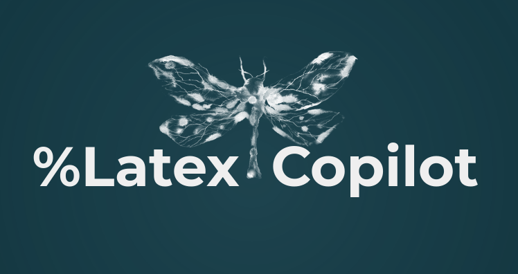
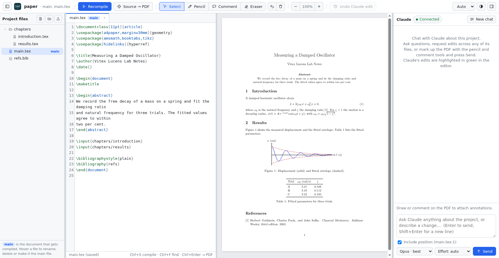

<p align="center"></p>

# Latex-Copilot

An Overleaf-style LaTeX editor that runs on your own computer, with Claude built in.
You get your project's files, the source and the compiled PDF side by side, plus a chat with Claude that can read and edit the whole project.
You can also draw on the PDF and pin comments to it, and Claude makes the matching changes in the `.tex` files.
No LaTeX source? Import a PDF, and Claude rebuilds it as an editable LaTeX document.



## Install

**macOS, Ubuntu (or another Linux), or WSL:** paste this into a terminal:

```bash
curl -fsSL https://raw.githubusercontent.com/Vitex-Lucens/latex_AI_copilot/main/install.sh | bash
```

**Windows 10 or 11:** paste this into PowerShell:

```powershell
irm https://raw.githubusercontent.com/Vitex-Lucens/latex_AI_copilot/main/install.ps1 | iex
```

The installer checks what Latex-Copilot needs and offers to install anything that's missing, asking before each step:

| | macOS | Ubuntu, Debian, WSL | Windows |
|---|---|---|---|
| **Python 3.10+** | Homebrew | apt | winget |
| **TeX**, to compile | MacTeX (a 5 GB download) | TeX Live from apt (about 1 GB) | MiKTeX and Strawberry Perl, from winget |
| **Ghostscript**, to import PDFs | Homebrew (MacTeX usually includes it) | apt | the official installer from ghostscript.com |
| **Claude Code** | Anthropic's installer | Anthropic's installer | Anthropic's installer |

Then it installs the app and a `latex-copilot` command, and finishes with `latex-copilot --check`, which lists anything still missing.
The app itself needs no admin rights: it lives in `~/.local/share/latex-copilot` (Windows: `%LOCALAPPDATA%\latex-copilot`).
Installing TeX and the other tools asks for your password (macOS, Linux) or for permission (Windows).

Afterwards, **open a new terminal**. The installer offers to sign you in to Claude straight away (it opens your browser). If you skip that, Latex-Copilot shows a **Sign in** button in its chat panel. It uses your own Claude account (Pro, Max, Team or Enterprise, or an Anthropic Console account), so there's no API key to manage.

- **From a copy** of this repository (a git clone or the zip): run `./install.sh` (macOS, Linux), or double-click `install.cmd` (Windows).
- **To update:** run the installer again.
- **To remove the app:** `~/.local/share/latex-copilot/install.sh --uninstall` (macOS, Linux) or `%LOCALAPPDATA%\latex-copilot\app\install.cmd -Uninstall` (Windows). Python, TeX, Ghostscript and Claude Code stay installed.
- **Other Linux distributions:** install Python 3.10+, TeX with `latexmk`, and Ghostscript with your package manager; the installer then installs the app.
- **To check your setup** at any time: `latex-copilot --check`.

## Use

```bash
cd path/to/your/latex/project
latex-copilot
```

Your browser opens Latex-Copilot at `http://127.0.0.1:8765`. Leave the terminal open while you work, and press **Ctrl+C** in it to stop.
The link it opens includes an access key, so other programs and other users on the computer can't use it. If you open the page some other way and it says so, use the link printed in the terminal.
Latex-Copilot finds the main document (the file with `\documentclass`) by itself. To pick a specific file, run `latex-copilot path/to/main.tex`.

| Area | What you can do |
|---|---|
| **Project files** (left) | Open files in tabs. Create files and folders, upload or drag in images, rename, delete. **★** makes a file the *main* document. Deleted files go to `~/.cache/latex-copilot/trash`, so you can get them back. |
| **Editor** | LaTeX highlighting, with separate undo per tab. **Ctrl+S** saves everything and recompiles. **Ctrl+F** finds text. **Ctrl+Enter** shows the cursor's line in the PDF. |
| **PDF** | **Select** tool: click any text to jump to its source line, in whichever file it lives. **Pencil** and **Comment**: mark up the page for Claude. **Eraser** removes marks. Zoom with **−/+**. |
| **Claude** (right) | The chip next to "Claude" shows whether you're connected; click it to sign in or to see the account. Ask questions ("is the notation in chapter 2 consistent?") or ask for edits ("shorten the abstract", "split the results into its own file"). Your pencil marks and comments are sent with your next message. With **Include position** ticked, Claude also sees your current file, line and any selected text. Claude's edits are highlighted in green, the PDF recompiles, and **Undo Claude edit** reverts the last one. **Stop** interrupts Claude; **New chat** starts a fresh conversation. Under the message box, pick the **model** (Opus writes best, Sonnet costs about half as much, Haiku is much cheaper and fine for small fixes) and the **effort** (low = quicker and cheaper). |
| **Layout** | Drag the thin bars between panes to resize them (double-click a bar to reset). The buttons at the far left and right hide the file tree and the chat. Choose Light, Dark or Auto theme; the **◐** button switches the PDF to a dark blue-green reading mode. |

### Import a PDF (no LaTeX source needed)

```bash
latex-copilot path/to/report.pdf
```

This makes a project folder next to the PDF (`report-latex/`) and opens it. Press **Convert to LaTeX**. You can also run `latex-copilot` in an empty folder and choose or drop a PDF on the page.

Claude rebuilds the document as LaTeX that looks like the original and is easy to edit:

- **Text stays text.** It comes from the PDF's own text layer, so the wording is exact, and Claude turns it into real headings, paragraphs, lists, tables, maths, footnotes and links.
- **Figures become two layers.** Each figure is cut out as an image with its text removed (`figures/fig-02-1.png`), and its labels (axis titles, legends, callouts) are put back on top as real, editable text (`figures/fig-02-1.tex`).
- **Designed pages** (covers, posters, forms) can use a positioned copy instead (`layers/page-01.tex`): the page's graphics with every line of text placed exactly where it was.
- **Scanned pages** (no text layer) are read from the page images.

How it works: the app first takes the PDF apart on your computer. It measures the page layout, fonts, colours, columns, tables and figures, and writes them into `import/extraction.md`, next to an image of every page. Claude then follows a written conversion process ([`latex_copilot/prompts/pdf-import.md`](latex_copilot/prompts/pdf-import.md)) a few pages at a time. After each part the app compiles the result, and, if **Check the result against the original** is ticked, Claude compares each compiled page with the original and fixes differences. When it's done, the **Original** button (or **O**) switches the PDF pane between your new document and the PDF you imported.

Conversion uses your Claude account like any other request: the model chosen under the chat box does the work. Opus is the most faithful; Sonnet costs about half as much and suits long documents. A 10-page document takes a few minutes. Generated files the final document doesn't use are moved to `import/unused/`, and the `import/` folder can be deleted once you're happy.

### Options

```
latex-copilot [PROJECT | MAIN.tex | FILE.pdf] [--engine pdf|xe|lua] [--model MODEL] [--port N] [--no-browser] [--latexmkrc]
```

- `--engine xe` or `--engine lua` compiles with XeLaTeX or LuaLaTeX. The default is pdfLaTeX. A first line `% !TEX program = xelatex` (or `lualatex`) in the main file does the same for that document.
- `--model` picks the Claude model. By default it uses your Claude Code default.
- `--port` sets the port. If 8765 is busy, it uses the next free one automatically.
- `--latexmkrc` uses the project's `latexmkrc` file. It's off by default because a `latexmkrc` is a program that runs on every compile: only use it for projects you trust (for example ones that need `-shell-escape`).

## Good to know

- **Claude edits files directly.** It can only read and edit files inside the project folder, and it can't run commands. Every edit is highlighted and can be undone with **Undo Claude edit**. Using git in the project is still a good idea.
- **Usage:** Claude runs on your own Claude account, so it counts towards that account's usage. Each reply shows its model and cost. The header of the chat shows how big the conversation has become and what it has used so far. As a guide, an edit from PDF annotations costs about 2–3 cents on Sonnet, and a quick question on Haiku about a tenth of a cent.
- **Keeping usage low:**
  - Use **Haiku** or **low effort** for small fixes.
  - Press **New chat** when you move on to something unrelated: every message re-sends the whole conversation, and the meter turns orange when it gets long.
  - Your PDF annotations are sent compactly: the text they cover, the matching `.tex` lines, and a small cropped image only for pencil marks.
  - Claude starts with only the file tools this app needs. None of your other Claude Code plugins, connectors or skills are loaded.
- **Security:** the app runs on your computer and only accepts connections from your own browser, with its access key. Compiling never runs code from the project (no `latexmkrc`, no shell escape); with older TeX Live a document also can't read files outside its project (newer TeX Live and MiKTeX don't enforce that). Claude can only read and edit files in the project. See [SECURITY.md](SECURITY.md).
- **Privacy:** only what you send to Claude leaves your machine: your messages, the files it reads, and images of the pages you annotated. Importing a PDF sends Claude the extracted text and images of the pages.
- **Problems?** Run `latex-copilot --check`. If the page shows "Lost connection", look at the terminal where Latex-Copilot is running, and at `~/.cache/latex-copilot/server.log`. To see exactly what was last sent to Claude, open `~/.cache/latex-copilot/last-prompt.md`.

## For developers

You can run it straight from this folder with `python3 -m latex_copilot [project]`; it only uses the Python standard library.
`python tests/smoke_test.py` checks everything that depends on the system (compiling, SyncTeX, the PDF import, the server); GitHub Actions runs it on Windows, macOS and Ubuntu for every push (`.github/workflows/test.yml`).
The PDF analysis can be run on its own, which is handy when working on it: `python3 -m latex_copilot.pdf_import original.pdf text.json out-folder`, where `text.json` is what `static/pdf-extract.js` returns for the PDF.
To try the multi-part conversion on a short document, start the app with `LATEX_COPILOT_PART_PAGES=2` (or `LATEX_COPILOT_PART_WORDS`) set.
It also works as a normal Python package: `pipx install .`
The bundled JavaScript libraries are listed in [THIRD_PARTY_NOTICES.md](THIRD_PARTY_NOTICES.md).
